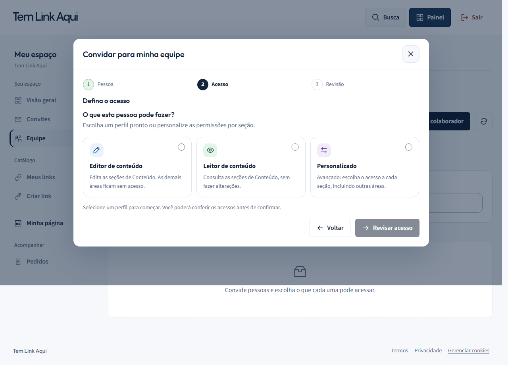
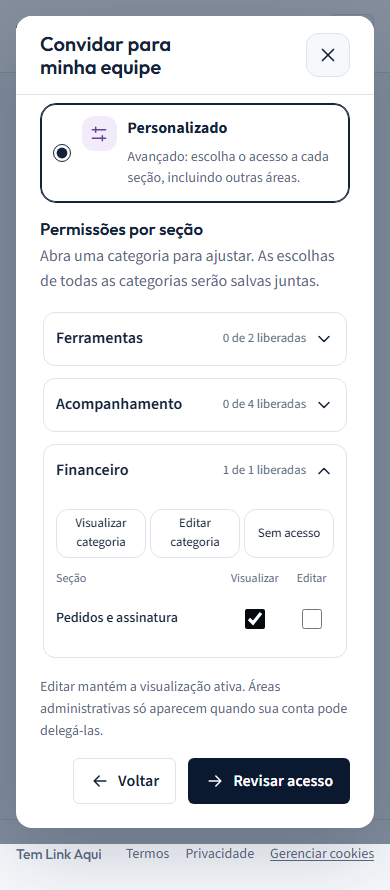

# Equipe e permissões guiadas — 19/10/2026

## Problema e entrega

A tela misturava colaboradores, acessos recebidos e compartilhamentos anteriores. O modal escondia categorias em um select e paginava três recursos, tornando o alcance das permissões difícil de perceber.

Agora há abas Minha equipe, Compartilhados comigo e Acessos por página. A terceira mantém disponível o fluxo anterior de compartilhamento individual, com seus contratos próprios. Removido o texto “Sua conta e os espaços compartilhados são separados”.

O convite tem etapas Pessoa → Acesso → Revisão. Editor de conteúdo e Leitor de conteúdo são atalhos de apresentação para grants existentes, restritos às seções do grupo Conteúdo retornadas pelo servidor. Não são novas roles globais. Personalizado mantém todas as categorias em seções expansíveis com contadores e rolagem, sem paginação. O resumo lista cada seção liberada e distingue visualizar de editar antes de criar convite ou salvar mudanças. Selecionar Personalizado não altera grants existentes.

A validação e a autorização do servidor, versão otimista, idempotência, validade e aceitação do convite, tenant e papel global permanecem nos contratos existentes. Nenhuma alteração de backend ou dependência nesta fatia.

## Referências e decisões

- [Notion: Sharing & permissions](https://www.notion.com/help/sharing-and-permissions): consultado no navegador real, incluindo a ilustração do menu Share; fundamenta a distinção explícita entre visualizar e editar e a identificação dos acessos concedidos. A escolha por cartões visíveis segue o pedido do usuário, sem copiar o menu da referência.
- [Slack: Types of roles](https://slack.com/help/articles/360018112273-Types-of-roles-in-Slack): fundamenta descrições claras por responsabilidade. A adaptação local usa conjuntos de grants já existentes, sem adotar cargos administrativos do Slack.
- Refero não está entre as ferramentas disponíveis nesta sessão. Não houve compra ou instalação.
- Navy e tokens locais preservados. Ícones existentes edit, eye e settings mantêm seus significados de editar, visualizar e configurar; cores acompanham texto e seleção nativa, nunca substituem rótulos.

## Verificação

- npm run lint --prefix frontend: passou.
- npm run typecheck --prefix frontend: passou.
- npm test --prefix frontend -- src/features/workspace-team/permission-editor.test.tsx src/components/layout/navigation-icons.test.tsx src/components/layout/site-navigation.test.tsx: 18 testes passaram.
- Playwright workspace-team.spec.ts nos projetos features e features-mobile: 9 testes passaram na rodada final, após o ajuste de apresentação das etapas em 320 px.
- TEMLINK_E2E_BUILD=1 npm run build --prefix frontend: passou (log em output/team-guided-build.log).
- O setup E2E também executa next build, com compilação, lint e tipos. Usa .next-e2e, sem sobrescrever o servidor de desenvolvimento.
- Isolamento: E2E_PORT_OFFSET=12000 e E2E_RUN_ID=team-guided. Portas 15000/15333/16099/16443/17433/18380; containers próprios divulgador-e2e-pg-team-guided e divulgador-e2e-redis-team-guided. Serviços já existentes em 3000/3333/5433/6380 preservados.
- Jornada real: convite, aceitação, gravação permitida, endpoints bloqueados, redução para leitura, revogação de sessão ativa, delegação administrativa sem promoção de role.
- UI: abas por teclado, foco por etapa, Escape e retorno de foco, estado vazio, perfis prontos, manutenção de seleção ao voltar, customização em outra categoria, resumo final e ausência de erros JavaScript no teste guiado.
- Axe WCAG A/AA na tela vazia e no modal avançado; capturas desktop 1280×720, mobile emulado 390×844 e 320×700 com fonte em 125%. As capturas foram examinadas; a primeira revisão identificou quebra ruim dos nomes das etapas em 320 px, corrigida empilhando número e nome.
- Não há certificação integral de acessibilidade, aparelho físico ou validação de produção. Capturas registram o estado renderizado, sem atualização automática de baselines visuais. A suíte completa de todos os módulos não foi executada.
- Avisos anteriores do build sobre autoprefixer em outros componentes não foram alterados.

## Arquivos e reversão

Alterados permission-editor.tsx, permission-editor.test.tsx, workspace-team-screen.tsx e workspace-team.module.css em frontend/src/features/workspace-team; frontend/e2e/workspace-team.spec.ts; registro de ícones e este documento. Os arquivos da feature já eram locais não rastreados: não usar git reset para desfazer.

Cópias anteriores desta fatia estão em output/team-guided-backup/. Para reverter somente esta tarefa, comparar e restaurar esses cinco arquivos de código/teste e remover apenas os registros documentais desta entrega, preservando outras mudanças locais.

## Capturas finais

Desktop: [tela de equipe](desktop-equipe.png), [perfis](desktop-guided-profiles.png), [avançado](desktop-guided-advanced.png), [revisão](desktop-guided-review.png).

Mobile emulado: [tela de equipe](mobile-equipe.png), [perfis](mobile-guided-profiles.png), [avançado](mobile-guided-advanced.png), [revisão](mobile-guided-review.png), [320 px e fonte 125%](mobile-guided-review-zoom.png).

