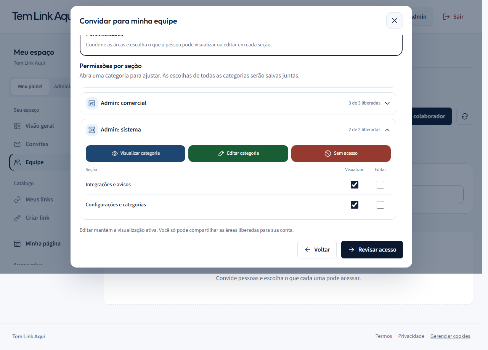

# Perfis de acesso e categorias — 19/10/2026

Refinamento solicitado após a primeira versão guiada. As áreas além de Conteúdo precisam ser descobertas pelos perfis prontos, sem depender de abrir Personalizado.

## Perfis

| Perfil | Escopo |
| --- | --- |
| Administrador | Leitura e escrita em todas as seções devolvidas pelo servidor, incluindo Financeiro e, se disponíveis, áreas administrativas. Não promove a role global nem concede gestão de conta/equipe. |
| Operador | Leitura e escrita em Conteúdo, Ferramentas e Acompanhamento. |
| Editor de conteúdo | Leitura e escrita em Conteúdo. |
| Analista | Somente leitura em Acompanhamento. |
| Financeiro | Leitura e escrita em Financeiro (pedidos e assinatura). |
| Leitor | Somente leitura em Conteúdo, Ferramentas, Acompanhamento e Financeiro; administração excluída. |
| Personalizado | Mantém a matriz existente e permite escolher cada seção. |

Os presets são atalhos para a matriz de grants existente. Somente seções recebidas do servidor entram na seleção; não são inventadas permissões administrativas. Perfis sem uma área correspondente não são exibidos. Abrir ou reconhecer um perfil não altera acessos. A antiga seleção de leitura somente de conteúdo permanece com seus grants e aparece como Personalizado; não é ampliada automaticamente.

Os nomes e a separação por responsabilidade se apoiam no pedido do usuário e nas referências [Slack — roles](https://slack.com/help/articles/360018112273-Types-of-roles-in-Slack) e [Notion — níveis de acesso](https://www.notion.com/help/sharing-and-permissions), consultadas novamente. Esses produtos não definem o contrato local: a tabela acima explicita a adaptação. Refero indisponível entre as ferramentas desta sessão.

## Categorias e ações

Categorias expansíveis receberam desenhos próprios para Conteúdo, Ferramentas, Acompanhamento, Financeiro e os três grupos administrativos. A seta mantém exclusivamente o significado de expandir/recolher; somente ela gira. Os atalhos têm preenchimento azul para visualizar, verde para editar e vermelho para retirar acesso, com ícone e texto. Em mobile, as ações ficam empilhadas para preservar alvos de toque e leitura.

Cores e ícones complementam rótulos; a revisão lista os acessos exatos antes de salvar. Sem alteração de backend, dependências ou contratos de autorização.

## Validação e reversão

- 31 testes de perfis, controles, navegação e ícones passaram.
- Lint e typecheck passaram durante implementação.
- 11 E2E passaram em features e features-mobile (inclui setup). O setup também executou next build com sucesso.
- Axe WCAG A/AA passou na tela vazia e nos modais avançados, inclusive com categorias administrativas. Revisão de capturas desktop 1280×720, mobile emulado 390×844 e revisão em 320×700 com fonte 125%; teclado, Escape, foco entre etapas e retorno, ausência de overflow, erros JavaScript e matrizes de acesso cobertos.
- A jornada manteve convite/aceitação, leitura/escrita, bloqueios de endpoints, redução e revogação em sessão ativa. Os novos cenários conferem Operador, Financeiro e Administrador contra 12 seções comuns e 21 seções quando o servidor libera delegação administrativa.
- Log E2E em output/team-profiles-e2e.log.
- E2E isolado com E2E_PORT_OFFSET=12000, E2E_RUN_ID=team-profiles; containers próprios e serviços existentes preservados.
- Cópias anteriores dos arquivos modificados em output/team-profiles-backup/. Para reverter esta fatia, comparar e restaurar apenas esses arquivos; remover os novos permission-profiles.ts e permission-profiles.test.ts e as adições documentais desta entrega. Não executar git reset, pois há mudanças locais anteriores.
- Arquivos: permission-editor.tsx, permission-editor.test.tsx, permission-profiles.ts, permission-profiles.test.ts, workspace-team.module.css; catálogo action-icon.tsx; e2e/workspace-team.spec.ts; registro de ícones e este documento.
- Não foi executada a suíte integral de todos os módulos. Emulação mobile não equivale a aparelho físico; validação local não certifica acessibilidade integral nem produção.

## Capturas

[Perfis no desktop](desktop-guided-profiles.png) · [Perfis no mobile](mobile-guided-profiles.png) · [Personalizado no desktop](desktop-guided-advanced.png) · [Personalizado no mobile](mobile-guided-advanced.png) · [Categorias administrativas no desktop](desktop-admin-categories-filled-actions.png) · [Categorias administrativas no mobile](mobile-admin-categories-filled-actions.png) · [Revisão do Financeiro](desktop-finance-profile-review.png).

